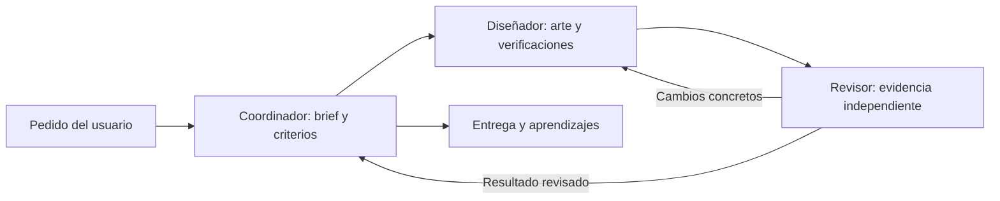

# Equipo operativo: coordinador, diseñador y revisor

El primer equipo está dedicado a Tribe (agendas, tazas y tomatodos). [Workflow y contratos](../workflows/tribe/operating-team.md). Los tres perfiles se guardan en `.codex/agents` y viajan con GitHub; la memoria de decisiones viaja en `.engram`.

Puedes pedir trabajo con palabras normales y añadir «usa el equipo operativo». No necesitas instalar otros skills para este equipo. Continúan siendo 21 skills; estos son 3 roles de agente, no 3 skills nuevos.

Durante la ejecución el chat principal indica la etapa, y los subagentes aparecen como hilos inspeccionables cuando el cliente lo permite. No están trabajando cuando no hay una tarea activa. Los perfiles nuevos pueden requerir un chat nuevo para su descubrimiento nativo; en la prueba inicial se pueden cargar sus instrucciones explícitamente.

El diseñador no certifica su propio resultado. El revisor puede aprobar dimensiones y dejar la calidad visual como NOT_VERIFIED si no pudo ver el archivo. Una entrega revisada no equivale a impresión certificada. Los archivos pesados quedan locales y solo se publican roles, reglas, informes ligeros y aprendizajes.

Primera ejecución: [informe de prueba del 2026-10-19](../evals/teams/operating-team-2026-10-19.md), tres delegaciones reales para revisión digital de una hoja existente. Sin generación nueva ni certificación de impresión; perfiles cargados por instrucciones, descubrimiento nativo pendiente.
